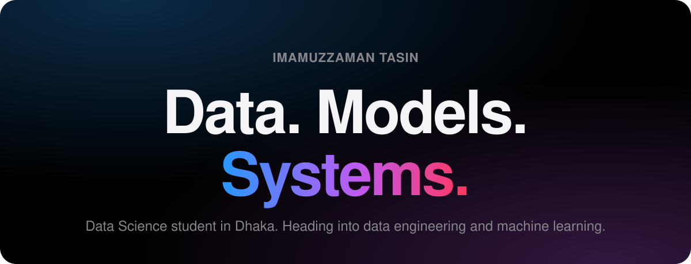

  

BSc Data Science, first year &nbsp;·&nbsp; Dhaka, Bangladesh

 

<h2 align="center">What I'm building toward.</h2>

I started with the web. Now I'm going deeper, into the data 
that powers products and the models that learn from it.

 

<table align="center">
  <tr>
    <td align="center" width="33%" valign="top">
      <h3>Data Engineering</h3>
      
Pipelines, databases and the infrastructure that keeps data reliable at scale.

    </td>
    <td align="center" width="33%" valign="top">
      <h3>Machine Learning</h3>
      
Understanding models from the math up, then shipping them as real products.

    </td>
    <td align="center" width="33%" valign="top">
      <h3>Foundations</h3>
      
Statistics, linear algebra, and clean Python. The part that doesn't go out of date.

    </td>
  </tr>
</table>

 

<h2 align="center">Toolkit.</h2>

<table align="center">
  <tr>
    <td align="center" width="33%"><b>Using</b>  JavaScript HTML &amp; CSS Git &amp; GitHub</td>
    <td align="center" width="33%"><b>Learning now</b>  Python Flask SQL</td>
    <td align="center" width="33%"><b>Next</b>  PostgreSQL &amp; Docker Airflow &amp; Spark scikit-learn &amp; PyTorch</td>
  </tr>
</table>

 

<h2 align="center">Earlier work.</h2>

Frontend projects where I learned to build for the web.

<table align="center">
  <tr>
    <td align="center" width="33%" valign="top">
      <h3><a href="https://github.com/ImamujjamanTasin/Apple.com">Apple.com</a></h3>
      
A replica of Apple's website.

      JavaScript
    </td>
    <td align="center" width="33%" valign="top">
      <h3><a href="https://github.com/ImamujjamanTasin/VERSE.com">VERSE</a></h3>
      
An e-commerce website.

      HTML
    </td>
    <td align="center" width="33%" valign="top">
      <h3><a href="https://github.com/ImamujjamanTasin/youtube.clone.com">YouTube Clone</a></h3>
      
A clone of YouTube's interface.

      HTML
    </td>
  </tr>
</table>

 

<h2 align="center">Let's talk.</h2>

  <a href="mailto:imamuzzaman.dev@gmail.com">imamuzzaman.dev@gmail.com</a>
  &nbsp;·&nbsp;
  <a href="https://www.facebook.com/imamujjaman.tasin">Facebook</a>

 
